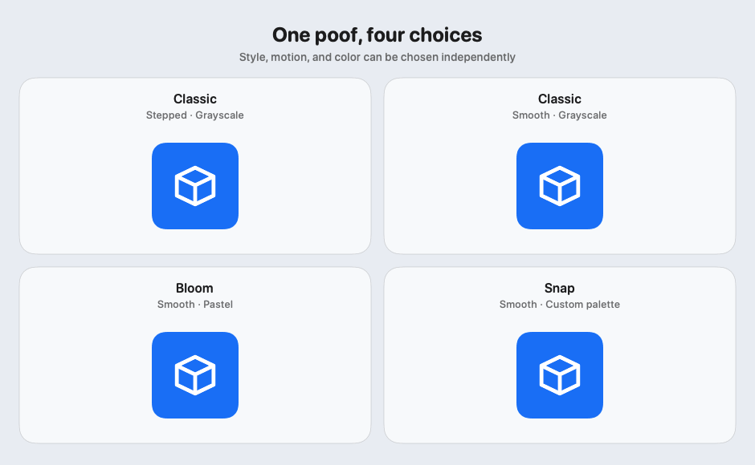

# Poof

[](https://github.com/hksw-io/poof/actions/workflows/ci.yml)

Poof brings AppKit’s retired disappearing-item animation to SwiftUI on OS 26
and later. Use it as a removal transition or trigger an independent poof at any
local point. It uses an original, clean-room `Canvas` renderer and does not
call the deprecated `NSAnimationEffect` API or ship copied system assets.

<table>
  <tr>
    <th>macOS light</th>
    <th>macOS dark</th>
  </tr>
  <tr>
    <td>
      <picture>
        <source media="(prefers-reduced-motion: reduce)" srcset="Documentation/Media/poof-macos-light.png">
        
      </picture>
    </td>
    <td>
      <picture>
        <source media="(prefers-reduced-motion: reduce)" srcset="Documentation/Media/poof-macos-dark.png">
        
      </picture>
    </td>
  </tr>
</table>

The animation swaps through five drawn poses at 15 frames per second,
one-third of a second in all.

## Requirements

- Xcode 26.4 or later
- Swift 6.3 or later
- iOS, macOS, tvOS, watchOS, or visionOS 26 or later

## Installation

In Xcode, choose **File → Add Package Dependencies** and enter:

```text
https://github.com/hksw-io/poof.git
```

Set the dependency rule to **Up to Next Major Version** from `1.1.0`.

See [CHANGELOG.md](CHANGELOG.md) for what changed between releases. Versions
follow [Semantic Versioning](https://semver.org): a breaking change, marked
**Breaking** there, comes only in a new major version.

From the root of another Swift package, SwiftPM can add Poof and link its
library product to a target:

```sh
swift package add-dependency https://github.com/hksw-io/poof.git --from 1.1.0
swift package add-target-dependency Poof YourTarget --package poof
```

Replace `YourTarget` with the name of the target that imports Poof.

For a package manifest, add the package and product dependency:

```swift
dependencies: [
  .package(
    url: "https://github.com/hksw-io/poof.git",
    from: "1.1.0"
  )
],
targets: [
  .target(
    name: "YourTarget",
    dependencies: [
      .product(name: "Poof", package: "poof")
    ]
  )
]
```

## Quick start

Attach the transition to the view being removed, then change its state with
`withAnimation(.poof)`:

```swift
import Poof
import SwiftUI

struct ExampleView: View {
  @State private var isVisible = true

  var body: some View {
    VStack(spacing: 24) {
      ZStack {
        if isVisible {
          Image(systemName: "shippingbox.fill")
            .font(.largeTitle)
            .transition(.poof(contentRemoval: .progressive))
        }
      }
      .frame(width: 80, height: 80)

      Button(action: toggleItem) {
        Text(isVisible ? "Remove" : "Restore")
      }
    }
  }

  private func toggleItem() {
    if isVisible {
      withAnimation(.poof) {
        isVisible = false
      }
    } else {
      isVisible = true
    }
  }
}
```

This example uses progressive removal so the smoke covers the source as it
disappears. The transition affects removal only, so restoring the view does
not play the animation backward. The `.poof` animation supplies the intended
linear, one-third-second timing.

## Styles and gradual removal

`classic` is the clean-room recreation and remains the default. Two opt-in
styles keep the same five-pose timing while changing the character of the
smoke:

| Style | Character |
| --- | --- |
| `.classic` | Crisp, compact grayscale smoke |
| `.bloom` | Round, full clouds with a cartoony pop |
| `.snap` | A tighter opening and punchier radial breakup |

Pass a style when you want something other than the classic poof:

```swift
.transition(.poof(style: .bloom))
```

Color is separate from style. Every style is grayscale by default, and
`PoofPalette.automatic` and `.monochrome` both use those grayscale fills.
Color is always opt-in: pass `.pastel` or your own colors through
`PoofPalette(colors:)` when the removal should be colorful:

```swift
let candy = PoofPalette(
  colors: [
    Color(red: 1.00, green: 0.63, blue: 0.52),
    Color(red: 0.48, green: 0.78, blue: 1.00),
    Color(red: 0.56, green: 0.90, blue: 0.68),
    Color(red: 0.78, green: 0.67, blue: 1.00),
  ]
)

RoundedRectangle(cornerRadius: 16)
  .transition(
    .poof(
      style: .snap,
      palette: candy
    )
  )
```

### Options at a glance

This comparison uses the same fixed seed in every card, so the differences come
from style and palette. The playback is slowed to one second here; the
library still plays each poof in one-third of a second.

<picture>
  <source media="(prefers-reduced-motion: reduce) and (prefers-color-scheme: dark)" srcset="Documentation/Media/poof-options-dark.png">
  <source media="(prefers-reduced-motion: reduce)" srcset="Documentation/Media/poof-options-light.png">
  <source media="(prefers-color-scheme: dark)" srcset="Documentation/Media/poof-options-dark.gif">
  <source media="(prefers-color-scheme: light)" srcset="Documentation/Media/poof-options-light.gif">
  
</picture>

The default `.immediate` removal hides the source as playback begins. Use
`.progressive` to let dense smoke cover the source before it disappears:

```swift
.transition(
  .poof(
    style: .bloom,
    contentRemoval: .progressive
  )
)
```

Progressive removal derives its cover from the source bounds, so the same API
works with compact icons, circles, wide capsules, and irregular shapes. The
smoke can cross the edge slightly to avoid tracing an obvious geometric
outline.

## Configuration

Pass a configuration to tune the breakup:

```swift
.transition(
  .poof(
    PoofConfiguration(
      particleCount: 36,
      spread: 0.90,
      fieldScale: 2.2
    )
  )
)
```

| Setting | Default and range | Purpose |
| --- | --- | --- |
| `particleCount` | `28`, clamped to `12...64` | Glyph count in the dense breakup pose |
| `spread` | `0.82`, clamped to `0.55...1.10` | Reach of the later breakup poses |
| `fieldScale` | `2.10`, clamped to `1.50...3.00` | Transparent drawing room around the source view |
| `seed` | `nil` | Optional repeatable variation |

Without a seed, Poof chooses one slight variation per playback and carries it
through all five poses. Use a fixed seed for snapshots, previews, or
synchronized effects. `fieldScale` adds transparent padding; it does not
enlarge the artwork.

## Poof at a point

Use the trigger-driven modifier when something should poof without removing a
view:

```swift
struct PoofPlayground: View {
  @State private var location = CGPoint.zero
  @State private var trigger = 0

  var body: some View {
    Image(systemName: "sparkles")
      .frame(width: 320, height: 180)
      .background(.fill.quaternary, in: .rect(cornerRadius: 16))
      .contentShape(.rect)
      .poof(
        at: location,
        style: .bloom,
        palette: .pastel,
        trigger: trigger
      )
      .onTapGesture(coordinateSpace: .local) { point in
        location = point
        trigger += 1
      }
  }
}
```

The initial trigger value is quiet. Every later change starts a separate
one-third-second poof centered at `location`, in the modified view's local
coordinate space, so rapid changes can overlap. The source view stays visible
and unchanged; it keeps hit testing and accessibility. Reduce Motion suppresses
the smoke, and an ancestor that clips its content may also clip the poof's
transparent overscan. The default artwork size is 84 points; `size:` is clamped
to 42...160 points.

## Manual control

Use `PoofEffect` when another interaction owns the progress:

```swift
struct PoofScrubber: View {
  @State private var progress = 0.5

  var body: some View {
    VStack {
      PoofEffect(
        progress: progress,
        style: .snap,
        configuration: PoofConfiguration(seed: 42),
        palette: .pastel
      )
      .frame(width: 120, height: 120)

      Slider(value: $progress, in: 0...1) {
        Text("Poof progress")
      }
    }
  }
}
```

The `style` and `palette` arguments are optional. `PoofEffect` draws
only the smoke, and values at either endpoint draw nothing.
When building a custom removal interaction, the caller is responsible for
hiding the source view, disabling hit testing, and removing it from the
accessibility tree. Use `.transition(.poof())` for the built-in behavior.

## Accessibility and appearance

- Reduce Motion makes `PoofTransition` fade the source view. Point-triggered
  poofs and standalone `PoofEffect` views draw no smoke.
- Reduce Transparency removes the soft shadow and keeps small shapes legible.
- Increased Contrast strengthens the outline and internal marks.
- Built-in colors stay the same in light and dark appearance. Custom SwiftUI
  colors may adapt to the environment if you pass semantic colors.
- The transition removes the source view from hit testing and the accessibility
  tree as removal starts. Its drawing canvas is never interactive or exposed to
  accessibility.

Check these settings with Xcode’s Environment Overrides or the system
accessibility settings. A deterministic dark preview can use:

```swift
#Preview("Dark") {
  PoofEffect(
    progress: 0.5,
    configuration: PoofConfiguration(seed: 42)
  )
  .frame(width: 120, height: 120)
  .preferredColorScheme(.dark)
}
```

Poof does not play a sound. An ancestor that clips its children can also clip
the drawing field.

## Performance

Poof seeds its glyphs once per playback and draws in one `Canvas`, with no
timer, per-frame random work, or SwiftUI view per glyph. Progressive removal
solves its mask off the main thread.

## Clean-room scope

Poof recreates observable timing, layout, and appearance with original Swift
and vector paths. The repository contains no copied Apple poof artwork or
frames, system sounds, legacy source code, private APIs, or extracted system
resources.

Poof is an independent project and is not affiliated with or endorsed by
Apple Inc.

## Development

Run the macOS demo:

```sh
make run
```

The demo applies surface, palette, appearance, and preview settings to every
style at once.

Run formatting checks, the debug and release package tests, and the media
generator tests:

```sh
make check
```

Regenerate the README GIFs after a rendering change:

```sh
make media
```

The media generator uses the public API, a fixed seed, SwiftUI
`ImageRenderer`, and ImageIO. It needs no third-party capture tools.

Bug reports and focused pull requests are welcome. Run `make check` before
submitting a change. [AGENTS.md](AGENTS.md) records the implementation rules
and repository conventions.

## License

Poof is available under the [MIT License](LICENSE).
