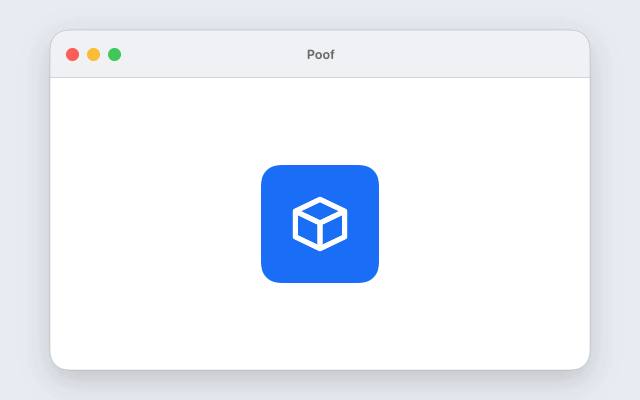
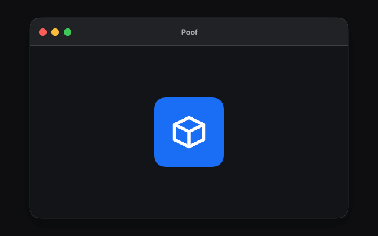
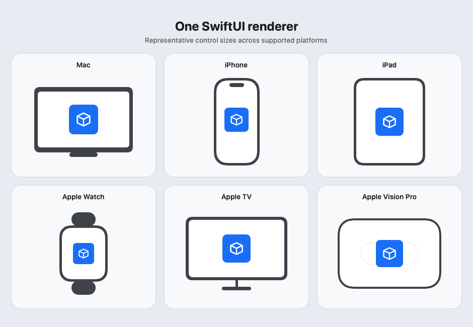

# Poof

[](https://github.com/hksw-io/poof/actions/workflows/ci.yml)

Poof brings AppKit’s retired disappearing-item animation to SwiftUI on OS 26
and later. It uses an original, clean-room `Canvas` renderer and does not call
the deprecated `NSAnimationEffect` API or ship copied system assets.

<table>
  <tr>
    <th>macOS light</th>
    <th>macOS dark</th>
  </tr>
  <tr>
    <td>
      <picture>
        <source media="(prefers-reduced-motion: reduce)" srcset="Documentation/Media/poof-macos-light.png">
        
      </picture>
    </td>
    <td>
      <picture>
        <source media="(prefers-reduced-motion: reduce)" srcset="Documentation/Media/poof-macos-dark.png">
        
      </picture>
    </td>
  </tr>
</table>

The animation swaps through five drawn poses at 15 frames per second. One
playback takes one-third of a second.

## Requirements

- Xcode 26.4 or later
- Swift 6.3 or later
- iOS, macOS, tvOS, watchOS, or visionOS 26 or later

## Installation

In Xcode, choose **File → Add Package Dependencies** and enter:

```text
https://github.com/hksw-io/poof.git
```

Set the dependency rule to **Branch** and enter `master`.

For a package manifest, add the package and product dependency:

```swift
dependencies: [
  .package(
    url: "https://github.com/hksw-io/poof.git",
    branch: "master"
  )
],
targets: [
  .target(
    name: "YourTarget",
    dependencies: [
      .product(name: "Poof", package: "poof")
    ]
  )
]
```

Poof does not have a tagged release yet, so installation currently tracks
`master`. Pin a revision when an application release needs an immutable
dependency.

## Quick start

Attach the transition to the view being removed, then change its state with
`withAnimation(.poof)`:

```swift
import Poof
import SwiftUI

struct ExampleView: View {
  @State private var isVisible = true

  var body: some View {
    VStack(spacing: 24) {
      ZStack {
        if isVisible {
          Image(systemName: "shippingbox.fill")
            .font(.largeTitle)
            .transition(.poof())
        }
      }
      .frame(width: 80, height: 80)

      Button(action: toggleItem) {
        Text(isVisible ? "Remove" : "Restore")
      }
    }
  }

  private func toggleItem() {
    if isVisible {
      withAnimation(.poof) {
        isVisible = false
      }
    } else {
      isVisible = true
    }
  }
}
```

Poof affects removal only, so restoring the view does not play the animation
backward. The `.poof` animation supplies the intended linear,
one-third-second timing.

## Supported platforms

The public renderer is shared by iPhone, iPad, Mac, Apple Watch, Apple TV, and
Apple Vision Pro. This gallery shows it at representative control sizes and
follows the README’s light or dark appearance.

<picture>
  <source media="(prefers-reduced-motion: reduce) and (prefers-color-scheme: dark)" srcset="Documentation/Media/poof-platforms-dark.png">
  <source media="(prefers-reduced-motion: reduce)" srcset="Documentation/Media/poof-platforms-light.png">
  <source media="(prefers-color-scheme: dark)" srcset="Documentation/Media/poof-platforms-dark.gif">
  <source media="(prefers-color-scheme: light)" srcset="Documentation/Media/poof-platforms-light.gif">
  
</picture>

The gallery is generated from `PoofEffect`, not recorded simulator footage.
Static frames replace the GIFs when Reduce Motion is enabled. CI builds the
package for every supported platform.

## Configuration

Pass a configuration to tune the breakup:

```swift
.transition(
  .poof(
    PoofConfiguration(
      particleCount: 36,
      spread: 0.90,
      fieldScale: 2.2
    )
  )
)
```

| Setting | Default and range | Purpose |
| --- | --- | --- |
| `particleCount` | `28`, clamped to `12...64` | Glyph count in the dense breakup pose |
| `spread` | `0.82`, clamped to `0.55...1.10` | Reach of the later breakup poses |
| `fieldScale` | `2.10`, clamped to `1.50...3.00` | Transparent drawing room around the source view |
| `seed` | `nil` | Optional repeatable variation |

Without a seed, Poof chooses one slight variation per playback and carries it
through all five poses. Use a fixed seed for snapshots, previews, or
synchronized effects. `fieldScale` adds transparent padding; it does not
enlarge the artwork.

## Manual control

Use `PoofEffect` when another interaction owns the progress:

```swift
struct PoofScrubber: View {
  @State private var progress = 0.5

  var body: some View {
    VStack {
      PoofEffect(
        progress: progress,
        configuration: PoofConfiguration(seed: 42)
      )
      .frame(width: 120, height: 120)

      Slider(value: $progress, in: 0...1) {
        Text("Poof progress")
      }
    }
  }
}
```

`PoofEffect` draws only the smoke, and values at either endpoint draw nothing.
When building a custom removal interaction, the caller is responsible for
hiding the source view, disabling hit testing, and removing it from the
accessibility tree. Use `.transition(.poof())` for the built-in behavior.

## Accessibility and appearance

- Reduce Motion makes `PoofTransition` fade the source view and suppresses the
  smoke. A standalone `PoofEffect` suppresses the smoke.
- Reduce Transparency removes the soft shadow and keeps small shapes legible.
- Increased Contrast strengthens the outline and internal marks.
- The grayscale artwork is designed for both light and dark appearance.
- The transition removes the source view from hit testing and the accessibility
  tree as removal starts. Its drawing canvas is never interactive or exposed to
  accessibility.

Check these settings with Xcode’s Environment Overrides or the system
accessibility settings. A deterministic dark preview can use:

```swift
#Preview("Dark") {
  PoofEffect(
    progress: 0.5,
    configuration: PoofConfiguration(seed: 42)
  )
  .frame(width: 120, height: 120)
  .preferredColorScheme(.dark)
}
```

Poof does not play a sound. An ancestor that clips its children can also clip
the drawing field.

## Performance

Poof generates seeded glyph descriptors once at playback start. Each render
selects one pose from absolute progress and draws it in one `Canvas`; there is
no timer, per-frame random work, or SwiftUI view per glyph. Glyph count and
field size stay bounded.

## Clean-room scope

Poof recreates observable timing, layout, and appearance with original Swift
and vector paths. The repository contains no copied Apple poof artwork or
frames, system sounds, legacy source code, private APIs, or extracted system
resources.

Poof is an independent project and is not affiliated with or endorsed by
Apple Inc.

## Development

Run the macOS demo:

```sh
make run
```

Run formatting checks, the debug and release package tests, and the media
generator tests:

```sh
make check
```

Regenerate the README GIFs after a rendering change:

```sh
make media
```

The media generator uses the public API, a fixed seed, SwiftUI
`ImageRenderer`, and ImageIO. It needs no third-party capture tools.

Bug reports and focused pull requests are welcome. Run `make check` before
submitting a change. [AGENTS.md](AGENTS.md) records the implementation rules
and repository conventions.

## License

Poof is available under the [MIT License](LICENSE).

Copyright © 2026 HK Softworks AB.
